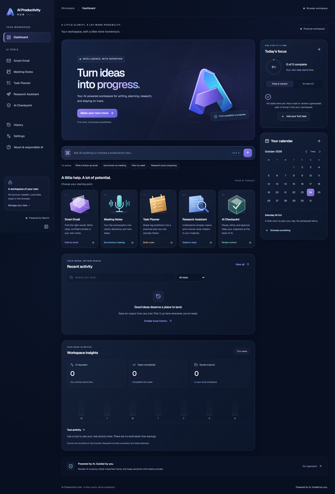

# AI Productivity Hub

A public, local-first workspace for writing, meetings, planning, research, and human review. Built for the CAPACITI AI portfolio project with Next.js, TypeScript and Google Gemini.

**Application:** [AI Productivity Hub](https://ai-productivity-hub-tshifhiwa11austin-4119.vercel.app) — public access, no registration.

**Repository:** [MamilaGun23/ai-productivity-hub](https://github.com/MamilaGun23/ai-productivity-hub)

The published version and current implementation status are recorded in [IMPLEMENTATION_PROGRESS.md](IMPLEMENTATION_PROGRESS.md). The original brief demonstrated Lovable; acceptance of the Next.js/Vercel platform substitution has not been independently confirmed.

## What you can do

| Workspace          | Functionality                                                                                                                                                                                           |
| ------------------ | ------------------------------------------------------------------------------------------------------------------------------------------------------------------------------------------------------- |
| Dashboard          | Original ribbon branding and glass interface; command shortcut and intent routing; saved activity search/filter/open/edit/copy/delete; real tasks, progress, calendar and usage insights.               |
| Smart Email        | Purpose, recipient, topic, tone, length and context; editable subject/body; regenerate, copy, save, export and human review.                                                                            |
| Meeting Notes      | Paste or import TXT/MD/VTT/DOCX/text-PDF; structured reports, editable actions, durable section processing and resume; Markdown/TXT/PDF exports and planner transfer.                                   |
| Task Planner       | Editable generated plans with priorities, deadlines, estimates and schedules; explicit review before adding tasks to the real focus list/calendar; completion and follow-up email drafts.               |
| Research Assistant | General model knowledge or analysis of supplied text; editable findings with clear evidence labels; selected findings transferred to an email draft. No live search or independent source verification. |
| AI Checkpoint      | Prompt testing and refinement, editable responses, actual version comparison and saved experiments; original manual/AI-assisted content review, revision, approve/reject/reopen workflow retained.      |

There are no fabricated user statistics, activity records or time-saved estimates. Automated tests use deterministic Gemini fixtures; the application calls the configured provider for real generation.

## Run locally

Use Node.js 24 and npm. Install exact dependency versions from the lockfile:

```powershell
npm.cmd ci
Copy-Item .env.example .env.local
```

Set these values in `.env.local`:

```dotenv
GEMINI_API_KEY=your-server-side-key
GEMINI_MODEL=gemini-3.5-flash-lite
RATE_LIMIT_PROVIDER=
UPSTASH_REDIS_REST_URL=
UPSTASH_REDIS_REST_TOKEN=
REQUIRE_RATE_LIMIT=false
```

```powershell
npm.cmd run dev
```

Open `http://localhost:3000`. Use `npm` instead of `npm.cmd` on macOS/Linux. `predev` and `prebuild` prepare the worker, fonts and character maps from the installed PDF.js version; extraction does not depend on a CDN. A valid Gemini key and available model quota are needed for generation. Never expose a key through a `NEXT_PUBLIC_` variable or commit `.env.local`.

The marker can use the published application directly without local setup. Running a GitHub checkout requires the steps above and a server-side Gemini key.

## Connected workflows

1. Import a meeting, generate a report, edit and select its actions, then choose **Plan selected actions**. Review dates and choose **Add selected tasks to workspace**. Dated tasks appear on the calendar; relative deadlines remain explicit for review.
2. Generate research, select findings and edit the transfer context, then open an email draft. The evidence basis travels with the context.
3. Open a task in the focus list or generated plan and draft a follow-up email using its details.
4. Enable local history in Settings, explicitly save an output, then open and edit it from Recent Activity or History.

Press **Ctrl/Cmd K** to focus the command bar. Clear tool-specific requests open the corresponding form with context prefilled. Ambiguous requests ask you to choose a tool; commands cannot execute arbitrary actions.

## Large transcripts

- Target: files and extracted text up to **25 MiB**. Browser extraction accepts TXT, Markdown, VTT, DOCX and text-based PDF. Scanned PDFs require external OCR. Mixed PDFs warn about pages without text; invalid/empty documents are rejected.
- Original files are not uploaded to a Vercel function. Small sections, including speaker/timestamp context, are sent through bounded AI requests.
- The pipeline maps every section, recursively combines summaries and creates a final report. Distinct actions, decisions, questions, risks and participants are retained from mapped findings; full section notes can be exported for review.
- Jobs save source text and completed steps in IndexedDB. Pause/cancel, network errors and quota waits preserve checkpoints. Closing the tab stops work; reopening allows resume. This is **resumable foreground processing**, not an unattended cloud queue.
- The public deployment shares **10 requests per 10 minutes per IP per region** across AI operations. Large documents may require many quota windows. File capacity is not a promise of immediate hosted completion.
- Chunking uses a conservative token upper bound and an explicit context/output budget. Limits and adapters are documented in [LARGE-TRANSCRIPTS.md](docs/LARGE-TRANSCRIPTS.md). A larger institutional workload needs an explicitly provisioned worker and quota budget.

## Data and privacy

IndexedDB stores saved outputs, tasks, calendar events, usage, prompt experiments and transcript jobs. localStorage holds lightweight preferences and supports migration of the previous history format. Migration removes the old copy only after a successful IndexedDB commit.

Saved AI history is optional and off by default. Tasks, events, usage and transcript checkpoints persist locally. Open unsaved drafts survive internal navigation in memory. Data is not synchronized across devices or encrypted by this application and can be lost when browser storage is cleared. Settings provides history deletion, a complete data export and all-data reset. Storage errors preserve available work in memory and display a recovery warning; stale tabs cannot silently overwrite newer workspace data.

Inputs selected for generation are sent to Google. Provider processing/retention follows the configured account's terms. Do not submit sensitive material without authorization. React renders generated content as text; uploaded content is untrusted evidence and cannot authorize application actions.

## Architecture and security

- Next.js App Router, React, strict TypeScript, Geist, Tailwind/CSS tokens, Lucide, Radix dialogs and Sonner.
- Official `@google/genai`, centralized structured output, Zod validation, separate feature prompts and bounded transient retries. Credentials stay server-side; raw private documents/provider errors are not logged or returned.
- `/api/ai/[feature]` handles the original tools; `/api/transcripts/step` handles bounded map/reduce/final steps; `/api/experiments` handles prompt tests/refinements. All enforce JSON/origin checks, a streamed 65,000-byte body limit and the shared managed rate allowance.
- Provider attempts time out after 15 seconds, with at most two retries for transport/5xx failures. Quota/auth/configuration/validation errors are not blindly retried. Routes allow 60 seconds; the client can recover or resume.
- Public production uses Vercel Firewall (`RATE_LIMIT_PROVIDER=vercel`). Other deployments can use the existing Upstash adapter. Missing production protection fails closed. Local development without configured protection is deliberately unlimited.
- Security headers, explicit errors, no raw HTML rendering, safe export names and spreadsheet formula protection remain in place. Public per-IP limits are not a complete distributed-abuse defense.

## Validation

```powershell
npm.cmd run typecheck
npm.cmd run lint
npm.cmd test
npm.cmd run build
npx.cmd playwright install chromium
npm.cmd run test:e2e
```

Tests cover the five tools, schemas, provider failures, browser storage failures/conflicts, transcript extraction/chunking/recursive merges/resume, real 25-MiB mock processing, prompt versions, task/calendar CRUD and connected flows. Routine tests make no paid Gemini calls. Exact executed results and remaining work are in [IMPLEMENTATION_PROGRESS.md](IMPLEMENTATION_PROGRESS.md).

For an accessibility/responsive audit against a running server:

```powershell
$env:QA_URL='http://127.0.0.1:3000'
node scripts/verify-visual.mjs
```

`scripts/verify-live-ai.mjs` is an explicitly opt-in, quota-consuming provider check (`RUN_LIVE_AI_TESTS=1`). Historical live results describe the earlier deployment; they are not proof of a new large-document production run.

## Deployment and project notes

[Vercel deployment guide](docs/DEPLOYMENT.md) · [Large transcript operations](docs/LARGE-TRANSCRIPTS.md) · [Prompt experiments](docs/PROMPT-EXPERIMENTS.md) · [Current implementation progress](IMPLEMENTATION_PROGRESS.md)

Source is under `src/app`, `src/components` and `src/lib`; tests are under `tests`; reproducible verification scripts are under `scripts`. GitHub Actions runs routine checks without live provider keys.

No mandatory accounts, subscriptions, cloud synchronization, web search, OCR, audio transcription or collaboration services are introduced. AI may omit facts or invent details; review important claims, owners, deadlines and recommendations before using them.



[Mobile dashboard](docs/screenshots/dashboard-mobile.png) · [Email workspace](docs/screenshots/email-workspace.png)
