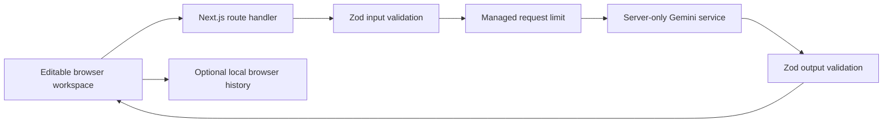

# AI Productivity Hub

A focused, public AI workspace that brings email writing, meeting summaries, project planning, research, and human review into one responsive dark interface. Built for a CAPACITI AI portfolio project.

**Live demo:** [Open AI Productivity Hub](https://ai-productivity-hub-tshifhiwa11austin-4119.vercel.app) — public access, no registration or local setup.

**Repository:** Source is prepared locally; a GitHub remote has not been published yet.

## Why this exists

Switching between writing, meetings, planning, and research creates busywork. This project gives each task a clear input, an editable AI result, and a path to a human decision. Its objectives are to demonstrate useful generative AI, typed full-stack development, accessible interaction, practical data control, and honest communication about model limitations.

The CAPACITI brief demonstrated Lovable. This implementation uses Next.js and Vercel. **Approval of this platform substitution has not been confirmed.**

## Features

| Tool                     | What it does                                                                                                                                                                                                                                      |
| ------------------------ | ------------------------------------------------------------------------------------------------------------------------------------------------------------------------------------------------------------------------------------------------- |
| Smart Email Generator    | Purpose, recipient, topic, six tones, three lengths and context; editable subject and body; separate copy actions, regeneration, text export and Checkpoint transfer.                                                                             |
| Meeting Notes Summarizer | Notes or safe `.txt`, `.md`, `.vtt` import; optional date and detail level; overview, discussion, decisions, editable actions with owners, deadlines, priority and completion; selected-action transfer to planner.                               |
| AI Task Planner          | Goal, deadline, tasks, priority, hours and constraints; ordered editable tasks, subtasks, estimates, dependencies, due dates, status, completion, deletion and reordering; list and data-driven schedule views; progress and Markdown/CSV export. |
| AI Research Assistant    | General model knowledge or analysis of pasted evidence; structured editable report, uncertainty, facts, arguments and unanswered questions; explicit evidence basis; no simulated browsing or fabricated citations.                               |
| AI Checkpoint            | Manual paste or tool import; optional AI analysis; approve, reject, reopen, feedback-based AI revision; retained prior versions for comparison; local decisions, reasons and timestamps; copying and export.                                      |

Shared features include responsive sidebar/drawer navigation, quick starts, input validation, loading and recovery states, optional local history, search/delete/clear, settings, and responsible AI guidance. No login, registration, authentication service, or database is required.

**There are no fake AI responses in the application.** A server API key is required for generation. Automated tests alone use deterministic fixtures and mock Google’s SDK or intercept browser requests.

## Stack & architecture

- Next.js 16 App Router, React 19, strict TypeScript, Tailwind CSS 4 and reusable CSS theme variables.
- Official `@google/genai` SDK, Zod request/output schemas and task-specific system prompts.
- Lucide icons, Radix accessible dialogs and Sonner status feedback.
- React state/context for open drafts; versioned and validated browser localStorage for explicit saves.
- Vercel Firewall managed rate limiting for the public deployment, with an optional Upstash Redis adapter for other deployments.
- Vitest, React Testing Library, Playwright, ESLint, and GitHub Actions.



`POST /api/ai/{email|meetings|planner|research|checkpoint}` handles all five tools. Checkpoint uses `action: review` or `action: revise`. The API returns `{ output }` or a safe `{ error }` response. Research output must match the requested evidence basis.

## Prerequisites

- Node.js 24 LTS and npm; Next.js requires Node 20.9 or later. Node 24 was used for verification.
- A Google AI Studio API key with access to the configured model and sufficient quota/billing.
- For public production: a Vercel account and either a configured Vercel Firewall SDK rule or Upstash Redis REST credentials. A GitHub repository is needed for source submission and optional automatic deployments.
- Git for publishing the source. Git was not available in the initial development environment.

Versions are pinned by `package-lock.json`; install with `npm ci` for repeatable setup.

## Local setup

```powershell
npm.cmd ci
Copy-Item .env.example .env.local
```

Edit `.env.local` locally:

```dotenv
GEMINI_API_KEY=your-server-side-key
GEMINI_MODEL=gemini-3.5-flash-lite
UPSTASH_REDIS_REST_URL=
UPSTASH_REDIS_REST_TOKEN=
REQUIRE_RATE_LIMIT=false
```

Never put the key in a `NEXT_PUBLIC_` variable or commit `.env.local`. No API key belongs in the browser or this chat. Restart the server after changing environment variables.

```powershell
npm.cmd run dev
```

Open `http://localhost:3000`. On macOS/Linux, use `npm` in place of `npm.cmd`.

The configurable default is stable `gemini-3.5-flash-lite`. Google documents text generation and structured-output support in its [model reference](https://ai.google.dev/gemini-api/docs/models/gemini-3.5-flash-lite). Model access and pricing depend on your account; no free-tier guarantee is made. Live model/account access is now verified locally; see the live verification update below. Google's [release notes](https://ai.google.dev/gemini-api/docs/changelog) indicate older 2.5 models have restricted access for new users.

## Using the workspace

1. **Email:** enter purpose and topic, choose tone and length, then generate. Edit subject/body, copy separately, download, regenerate with the same instructions, or send to Checkpoint.
2. **Meetings:** paste notes or upload a supported text file (maximum 100 KB and 12,000 extracted characters). Generate, edit the summary and actions, select relevant actions, and choose **Plan selected actions**. Unknown owners/deadlines remain explicit rather than being invented.
3. **Planner:** describe the goal, optionally specify a deadline/hours, then generate. Edit tasks, change status, check completion, reorder or delete tasks. Switch to Schedule to see the generated schedule for the same tasks. Estimates are suggestions. Save locally to revisit through History, or export Markdown/CSV.
4. **Research:** choose **General AI knowledge** for an explanation or **Analyze supplied material** to paste evidence. Set depth and objective, then generate. The response labels its basis; no live browsing occurs. Edit and verify before relying on it.
5. **Checkpoint:** paste or import content. Use AI-assisted review for advisory feedback. Add feedback and request revision to preserve the preceding version and generate a revised draft. Compare previous versions, edit further, then approve or reject. Reopen a decided draft for editing. With local history enabled, human decisions are saved locally.

Enable **Settings → Local workspace history** before saving. History is off by default. **Save locally** stores up to 50 items in this browser, including editable output and form inputs. It is not synchronized or application-encrypted. Clearing saved history is permanent; export a copy first. Open drafts survive internal navigation in memory but are lost on refresh unless explicitly saved. Turning history off does not delete existing saves.

## Project structure

```text
src/
  app/
    page.tsx                 Dashboard
    [tool]/page.tsx           Five generated tool routes
    api/ai/[feature]/route.ts Node route and execution limits
    history/ settings/ about/ Supporting pages
    globals.css              Responsive layout and design tokens
  components/
    shell.tsx                Sidebar, topbar, accessible mobile drawer
    tool-workspace.tsx       Forms, editable results and review flows
    workspace-provider.tsx   In-memory drafts and local history
    ui.tsx                   Buttons, copy/export, dialogs and feedback
  lib/
    contracts.ts             Zod schemas and shared types
    ai/                      Gemini service, handler and system prompts
    security.ts              Persistent rate-limit adapter
    storage.ts               Versioned local history validation
    utils.ts                 Dates, progress, parsing and safe export
tests/
  unit/ integration/ components/ e2e/
docs/                        Deployment and verification evidence
.github/workflows/ci.yml      Repeatable automated checks
```

## Security & privacy

- Keys stay in server-only modules. Provider errors are classified; raw provider messages and stack traces are not returned or logged.
- Every request and model response is validated. Bodies are capped at **65,000 bytes**, checked while reading rather than relying only on Content-Length. Most input fields are capped at 12,000 characters; Checkpoint content allows 60,000 characters subject to the byte limit.
- JSON-only requests, same-origin browser checks, bounded output tokens (8,192), and a 45-second provider timeout limit resource exposure. The client has a 55-second recovery timeout and Vercel routes allow 60 seconds.
- Production uses the configured Vercel Firewall rule: **10 requests per 10 minutes per client IP per region**, across all tools. The optional Redis adapter uses a shared sliding window. Missing rules, missing credentials for the selected backend, or unavailable protection fail closed. Development without Redis has no application rate limiter; it is not represented as production protection.
- On Vercel, the address comes from the platform's `x-vercel-forwarded-for` header. See [Vercel request headers](https://vercel.com/docs/headers/request-headers). Other hosts need an audited trusted-proxy adapter; local development intentionally uses a shared local identifier.
- No server-side transcript/output persistence or analytics. Upstash holds short-lived rate counters and hashed identifiers. Hosting and AI providers may process metadata under their terms.
- Pasted/uploaded content is explicitly separated from system instructions and treated as untrusted evidence. Prompt injection cannot be guaranteed eliminated; the application executes no model/user code and exposes no external action tools.
- React renders output as text; no raw HTML execution. CSV exports neutralize spreadsheet formula prefixes. Filename sanitization applies to exported files.
- Security headers include framing denial, nosniff, permissions restrictions and a CSP. The CSP permits inline scripts/styles and eval for framework compatibility; it is not claimed as a strict nonce-based policy.
- Public per-IP limits do not prevent distributed abuse. Set provider spend/quota caps and consider Vercel Firewall rules before broad exposure.

## Responsible AI

AI content may be inaccurate, incomplete, biased, or outdated. Verify important claims, dates, owners, estimates and recommendations. Source mode is grounded only in the supplied material, not external verification. Review suggestions do not certify facts or safety. Keep sensitive/confidential information out of prompts unless authorized. Inputs are sent to Google; retention and processing depend on the configured account's terms. See the in-app **About & responsible AI** page.

## Testing

```powershell
npm.cmd run typecheck
npm.cmd run lint
npm.cmd run test
npm.cmd run build
npx.cmd playwright install chromium
npm.cmd run test:e2e
```

Unit tests cover validation, malformed storage, normalization, VTT parsing, progress, dates and export escaping. API tests mock the official Gemini SDK and test request/response validation, configuration, quota/error handling, origin/size guards, and evidence basis. Security tests cover production fail-closed behavior and managed rate limiting. Component tests cover validation, duplicate prevention, error recovery, output editing, task completion, approval and reopening. Playwright covers the five modules and integrated flows with deterministic network fixtures. No routine test spends Gemini quota.

See [verification evidence](docs/VERIFICATION.md) for actual executed results. CI is configured but is not claimed to have run on GitHub until the repository is published.

## Deployment

Follow [the Vercel deployment guide](docs/DEPLOYMENT.md). Configure all four production environment values, deploy, smoke-test all five modules with live Gemini, and verify public access in a signed-out browser. The development server and a successful local build are not a hosted deployment.

## Screenshots

Actual browser captures, when available, are stored under `docs/screenshots/`. AI output shown in test screenshots is deterministic test data, not evidence of a live provider call.


[Mobile dashboard](docs/screenshots/dashboard-mobile.png) · [Email workspace](docs/screenshots/email-workspace.png) · [Planner with deterministic test data](docs/screenshots/planner-test-fixture.png)

## Live verification update

Seven real Gemini requests now pass across all five tools, including both research modes and Checkpoint revision. See [live verification evidence](docs/LIVE-AI-VERIFICATION.md). The provider-facing JSON schema is simplified for compatibility; full Zod limits remain enforced on returned output. The current regression suite has 48 passing tests, and typecheck, lint and the production build pass.

To repeat live checks, start the dev server, set `RUN_LIVE_AI_TESTS=1`, then run `node scripts/verify-live-ai.mjs`. This consumes provider quota and is excluded from routine tests and CI.

## Known limitations

- Live Gemini generation is now verified locally: seven real API checks passed across all five tools, both research modes and Checkpoint revision. Production still requires hosting secrets and a production smoke test.
- The app is deployed and public. A GitHub remote repository still needs publication; no GitHub URL has been fabricated.
- No web search, audio transcription, collaboration, cloud synchronization, or rich-text editor. These are intentional scope limits.
- Local saves depend on browser storage and device access. Blocked, corrupt, old-version, or full storage is reported; use exports as a backup.
- Public Vercel Firewall rate limiting is configured and live-verified. Upstash is an optional alternative; its live service has not been configured or tested.
- Five high-severity audit entries affect the development lint dependency chain (`braces → micromatch → fast-glob → Next ESLint plugin/config`). At implementation time npm supplied no patched current-chain version; its proposed forced fix downgraded the Next tooling. Production dependency audit was clean. Track upstream fixes; do not run lint on untrusted glob patterns.
- Accessibility is designed toward WCAG 2.2 AA but is not a formal conformance certification.
- CAPACITI acceptance of the alternative development platform requires separate confirmation.

## Future improvements

Potential additions after public verification: optional grounded live search, calendar export, richer document editing, stricter nonce-based CSP, and broader cross-browser/accessibility audits. Authentication and a database are not prerequisites for the current product.
